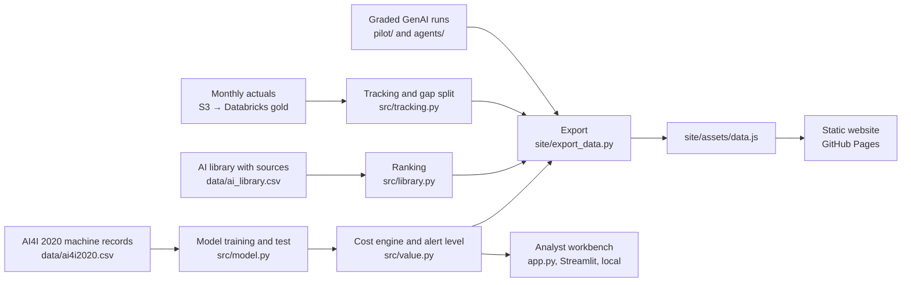

# Architecture

How The ROI Compass is built: where each number comes from, how the website stays in step with the Python model, and how it is deployed. For the product view, see the [PRD](docs/prd.md); for requirements and acceptance tests, the [requirements pack](docs/requirements.md).

## System overview



The Python in `src/` is the single source of truth. The website never recomputes a model: it reads the exported results and applies the same cost formula in the browser.

## Folders

| Folder | What it holds |
|---|---|
| `src/` | The engine: model (`model.py`), dollar formula and alert level (`value.py`), library ranking (`library.py`), readiness rules (`readiness.py`), tracking and gap split (`tracking.py`), decision brief PDF (`brief.py`), GenAI cost model (`genai.py`, `workorder.py`, `agents.py`) |
| `site/` | The public website: `index.html`, one page per phase in `phases/`, shared code and styles in `assets/`, and `export_data.py`, which writes `assets/data.js` |
| `data/` | AI4I 2020 dataset, the AI library with sources, the simulated 12-month rollout, and the pipeline's exported gold table |
| `pipeline/` | S3 landing and Databricks bronze / silver / gold job |
| `pilot/`, `agents/` | The two Amazon Bedrock experiments: test cases, saved runs, graders |
| `tests/` | Unit tests for every formula the site shows (`pytest`) |
| `docs/` | PRD, requirements pack, solution design, roadmap, delivery log, sample decision brief |
| `app.py` | Streamlit analyst workbench (runs locally; the only place the GenAI agents can run live) |

## The model

- **Data:** 10,000 synthetic machine records, 339 breakdowns. Stratified 70/30 split; every reported metric comes from the 3,000 test records.
- **Features:** five sensor readings, product type, and three engineered features (power, temperature difference, wear × torque). The failure-cause columns are excluded because they describe the failure itself.
- **Models:** logistic regression (explainable baseline, AUC 0.91) and gradient boosting (AUC 0.99). The dataset's failures were generated from rules on the same engineered quantities, so 0.99 is a best case, not what a real plant would see. The business case therefore plans on published results ($290k a year), not on the model test ($658k).

## The dollar formula

At any alert level the test set gives caught (TP), missed (FN) and false-alarm (FP) counts, scaled to the plant's breakdowns a year:

```
cost without AI = breakdowns × cost of a breakdown
cost with AI    = caught × planned repair + missed × cost of a breakdown + false alarms × inspection + running cost
net a year      = cost without AI − cost with AI
payback         = months to go live + setup ÷ (net ÷ 12)
```

**Alert level (break-even).** An alert on a machine that would fail saves (breakdown − planned repair); an alert on one that would not costs an inspection. Alerting pays when chance × saving > (1 − chance) × inspection, so the level is inspection ÷ (saving + inspection): $500 ÷ $21,500 ≈ 2% at the default costs. It is set from the costs, never tuned on the test set, so the test stays an honest check. Code: `alert_threshold()` in `src/value.py`.

## How the website stays in step with Python

`site/export_data.py` calls the same `src/` functions and writes `site/assets/data.js`, including:

- `curve`: the test-set caught and false-alarm counts at every alert level from 1% to 99%;
- `rules`: the same counts for the maintenance manual's rules;
- the library ranking, readiness questions and actions, the 12 monthly records and the gap split, and the GenAI scores.

The browser's `value()` and `breakEven()` in `site/assets/site.js` repeat the formulas above on those counts. They were checked against Python to the dollar ($658,431 at the defaults; $138,824 with a $10k breakdown). Re-run the export whenever `src/` or `data/` changes.

## Website state

Plain JavaScript, no framework and no build step.

- **Calculator** (Business case → Show the details): the inputs are the state. Each what-if changes one input on top of the others, and a line lists everything that differs from the base assumptions. Every change re-runs one `draw()` that prices the AI, the rules and doing nothing, fills the side-by-side table and runs the board's tests. The inputs are kept in `sessionStorage` for the visit, so leaving the page and coming back keeps them; pinned columns live in memory only.
- **Board:** `board()` in `phases/business-case.html` (kept with the page that draws it, so a cached page and a newer shared script can never disagree) is a set of fixed, documented rules that give the CFO, COO and CTO a reaction in their own words (payback, savings given up against break-even, false alarms a week, share of alerts that are real, catch rate, running cost). Each reaction shows two ✓/✗ checks, the same thresholds as the pilot's exit checks on Deliver, and can carry a fix (new input values or an alert level). The board never changes anything itself: a fix is applied only when clicked, and can be undone.
- **Readiness** ratings, the "Show the details" toggle and the staircase all redraw from the page's inputs.
- **Browser storage:** which phases the visitor has opened (`roi-visited`, used to colour the staircase) and the calculator's inputs for the current visit (`roi-calc`). If storage is blocked, the site still works.
- **3D characters:** three.js r128 from cdnjs, with a flat fallback when WebGL is not available.

## Data pipeline

Monthly actuals land in a private, encrypted S3 bucket (us-east-2). `pipeline/run.py` syncs them to Databricks Free Edition and runs `pipeline/notebook.py`: **bronze** loads each file once, **silver** applies the checks and quarantines bad rows with the reason, **gold** computes savings, adoption and drift in SQL. A unit test confirms gold matches the Python formula to the cent. The site reads the exported gold table, so it needs no credentials.

## Deployment

| Surface | How it updates |
|---|---|
| Website | GitHub Pages from the `gh-pages` branch: `git push origin "$(git subtree split --prefix site HEAD)":refs/heads/gh-pages`. Assets are cached for up to 10 minutes. |
| Repository | `main` holds the code, documents and the site's source |
| Workbench | `streamlit run app.py`, locally |

## Testing

`pytest` runs 23 tests covering the dollar formula, alert level, ranking, readiness verdicts, scenarios, bootstrap ranges, tracking alerts and the exact gap split. The website pages are checked in a browser at desktop and phone width for errors before each release.
