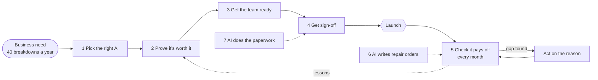

# AI ROI Navigator

> From a business problem to an AI that pays off, with a check every month that it still does.

A portfolio project in **AI business systems analysis**. It follows one AI project through every step a business systems analyst owns: understand the business need, pick the AI that fits it, prove it is worth the money, check the team is ready, get finance to sign off, and after launch check every month that it delivers what was promised. The worked example is a mid-size factory losing $1.0M a year to surprise machine breakdowns.

## The whole process



| Step | Question | What the app does |
|---|---|---|
| **1 · Pick the right AI** | Which AI fits this business need? | Checks 12 AI options against the business's main problem, data quality, tolerance for AI mistakes and how fast it needs results, and gives the reasons. A factory, a hospital network and an online retailer get three different answers, or describe your own. |
| **2 · Prove it's worth it** | Does it save more than it costs? | Sets a real breakdown-warning AI to **save the most money, not to be the most accurate**, with ranges and best / worst cases. |
| **3 · Get the team ready** | Will people use it? | 10 questions in 5 areas, a Go / Fix first / Not ready verdict and the fixes. |
| **4 · Get sign-off** | Will finance approve it? | A one-page business case to download. |
| **5 · Check it pays off** | Is it delivering what was promised? | Compares savings with the promise each month, explains the gap, and warns when the crew ignores warnings or the AI gets worse. Data arrives through an **S3 → Databricks** pipeline. |
| **6 · AI writes repair orders** | Can a writing assistant be trusted? | A measured Amazon Bedrock pilot that drafts repair orders, with the full cost counted. |
| **7 · AI does the paperwork** | Can AI check a business case? | Three AI helpers on Amazon Bedrock, each tested on cases with known answers. |

Every page shows **the answer first** (the question, the answer, three numbers, one chart, what to do next) and **the details on demand** under *Show the details*.

## Analysis documents

| Document | What is in it |
|---|---|
| [Requirements pack](docs/requirements.md) | Process maps today and with AI, integration spec (warning → work order), data dictionary, 12 user acceptance tests, requirements traceability matrix |
| [Solution design](docs/solution_design.md) | Stakeholders, use cases, 36+ user stories with acceptance criteria and MoSCoW priorities, fishbone of why value falls short, RACI |
| [Roadmap](docs/roadmap.md) | Now / Next / Later, prioritised with the same value × ease scoring the app uses |
| [Delivery log](docs/delivery.md) | How the work was split into increments and checked |

*Independent concept project. Solution scores, example clients and plant costs are illustrative assumptions and can be edited in the app.*

## Key result (default assumptions)
On 3,000 machine records the model never saw during training, a gradient-boosting model:
- catches **~86% of failures** with **~80% of alerts being real**
- yields **~$660K annual net savings** for a plant with 40 failures a year, with a **~4.7-month payback**
- **The result holds up under pessimistic assumptions.** Model uncertainty puts annual savings at **$611K–$704K** (90% range). In the low case, with every cost assumption at its unfavorable end, the project still saves **~$164K a year** and pays back in **~20 months**. The biggest driver is the cost of an unplanned failure, so that's the number to agree with finance first.
- **Forecasts need checking after launch.** In a simulated 12-month rollout the plant banks **$464K of the $660K forecast (70%)**. Step 5 splits the $197K gap into fewer failures than assumed (−$91K), the crew ignoring correct alerts in the first months (−$63K) and model drift (−$46K), and raises a retrain alert in month 11.
- **For GenAI, the model fee is not the cost; review time is.** A 30-alert pilot on Amazon Bedrock (Nova Micro) cost **$0.04 per 1,000 drafts**. When the model diagnosed the fault itself it was right only **33%** of the time; moving the diagnosis into a rule check and letting the model only write raised that to **100% on real failures**. With 4-minute reviews the assistant returns **72% in year one**, but only **−14% in cash** if half the saved hours turn into money, and it stops paying once review takes more than **~10 minutes** a draft.
- **Agents need evals, and evals show where code beats prompts.** Three Nova Lite agents were graded on 19 cases with known answers. Version 1 got **42%** of intake fields right, invented a number in a memo and caught **3 of 6** planted flaws. Letting the model only quote numbers (code converts units and fills them into the memo) made intake and memos exact. The red team still failed until a code checklist decided what was implausible and the model only explained it: **6 of 6** flaws caught, **0** false alarms, for about **$0.001** a run.
- **The most accurate setting is not the most profitable.** Tuning the alert threshold for dollars instead of accuracy saves **~$29K more per year**, because a missed failure ($25K) costs far more than a false alarm ($500).

**Overview** (the landing page)


| 1 · Pick the right AI | 2 · Prove it's worth it |
|---|---|
|  |  |
| **3 · Get the team ready** | **4 · Get sign-off** |
|  |  |

**5 · Check it pays off** (simulated 12-month rollout, delivered through the S3 → Databricks pipeline)


**6 · AI writes repair orders** (measured on Amazon Bedrock)


**7 · AI does the paperwork** (tested on Amazon Bedrock)


## How it works
- **Matching and ranking:** weighted 1–5 scores. Value = financial impact, strategic fit, scale. Feasibility = data readiness, ease of build, low risk, speed to value. Weights are adjustable.
- **Model:** AI4I 2020 dataset (10,000 records, 339 failures). Features: temperatures, speed, torque, tool wear, plus engineered power, temperature difference and wear × torque. Failure-mode columns are excluded to avoid leakage. Logistic regression (explainable baseline) vs gradient boosting; stratified 70/30 split.
- **Dollars:** test-set catch, miss and false-alarm rates are scaled to the plant's failures per year. Savings = cost of failures without AI − (planned repairs + missed failures + false alarms + running cost).
- **Uncertainty:** *model uncertainty* comes from a bootstrap of the test set (1,000 resamples, 90% range). *Assumption uncertainty* comes from a tornado chart that moves each cost input between an editable low and high value one at a time, plus low / base / high cases that set every input to its unfavorable or favorable end.
- **Value tracking:** monthly counts (alerts, failures flagged, prevented, missed, false alarms) are turned into dollars with the same formula as the forecast. Adoption = share of alerts acted on (alert below 70%). Drift = 3-month rolling recall 10+ points below launch. The gap is split by swapping each forecast assumption (failure volume, recall, share of flagged failures acted on, false alarms) for its actual value one at a time, so the parts add up exactly. The bundled 12-month rollout is simulated, not real plant data.
- **GenAI pilot:** 30 alerts from the test set (real failures of each type plus false alarms) are sent to Amazon Nova Micro on Bedrock (us-east-2, US inference profile, temperature 0, 500-token cap). Each draft must name one cause from a fixed list, graded against the true cause in the data. ROI counts the five cost categories from the Forbes article (usage, setup, review, training, errors) and splits time saved into cash and capacity. Re-run with `python -m pilot.run_pilot --profile <aws-profile> --version 2`.
- **Data pipeline:** monthly actuals files land in a private, encrypted, versioned S3 bucket (us-east-2, access logged to CloudWatch). `pipeline/run.py` syncs them into a Databricks Free Edition volume (Free Edition cannot mount your own S3; with paid Databricks this becomes a Unity Catalog external location) and runs `pipeline/notebook.py` as a serverless job: **bronze** loads files once with `COPY INTO`, **silver** applies the Track value checks and sends failing rows to **quarantine** with the reason, **gold** computes savings, adoption and drift in SQL. A unit test confirms gold matches the app's Python formula to the cent; a planted bad file is quarantined. Run with `python -m pipeline.run land sync run fetch --aws-profile <profile>`.
- **Analyst agents:** Amazon Nova Lite on Bedrock (us-east-2, temperature 0). 8 intake descriptions, 2 memos and 9 red-team cases (a sound case plus 8 with one planted flaw) live in `agents/eval_cases.json`; `python -m agents.grade` scores saved runs. The public app shows saved results; live intake runs only where AWS credentials exist.
- **Readiness:** 5 areas (data, fits how people work, clear payoff, people trust it, clear ownership). Go = average ≥ 3.5 and no dimension below 2.5.

## Run locally
```bash
pip install -r requirements.txt
streamlit run app.py
pytest            # optional: run the tests
```

## Data
Matzka, S. (2020). *AI4I 2020 Predictive Maintenance Dataset*. UCI Machine Learning Repository. Licensed CC BY 4.0.

## Author
Chaitali Shekar · MS Engineering Management, NC State University


## Why I built this

In *AI's Hidden Problem: Nobody Revisits the Original Decision* (Substack, August 2026) I argued that most AI waste comes from decisions that were right when they were made and never revisited once the facts changed. Step 5 of this app is that revisit: it goes back to the business case every month and asks whether its assumptions still hold.

## How it was managed

User stories with acceptance criteria and MoSCoW priorities, a fishbone of why value falls short, a RACI for who owns what after launch, and a log of the delivery increments: [docs/solution_design.md](docs/solution_design.md) and [docs/delivery.md](docs/delivery.md).
