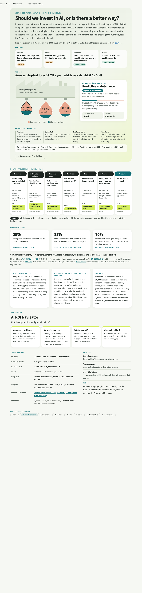
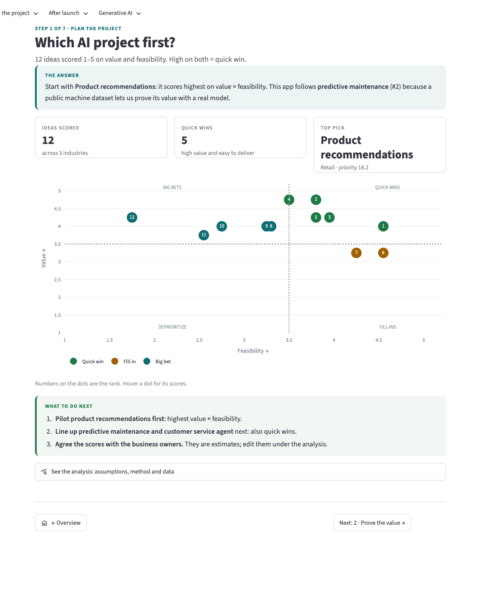
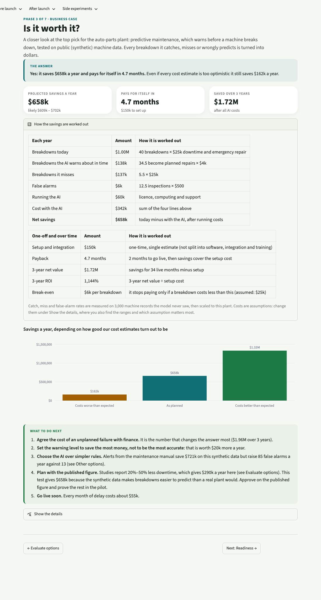
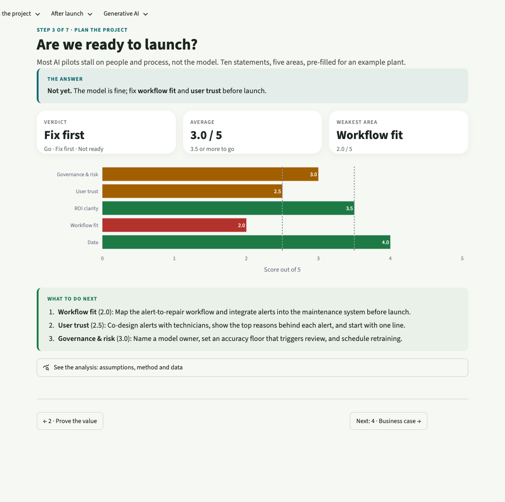
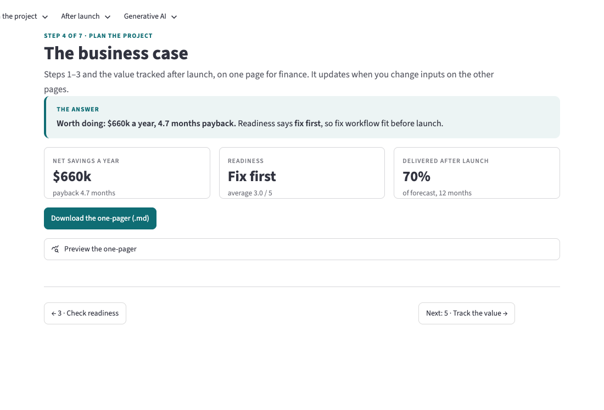
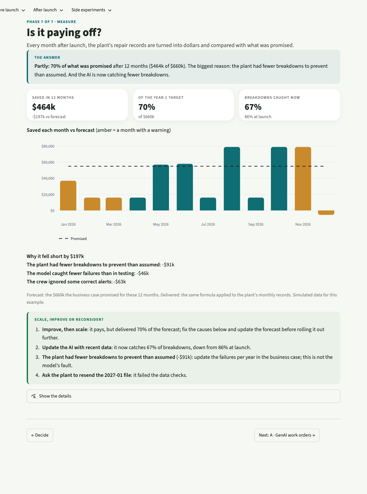
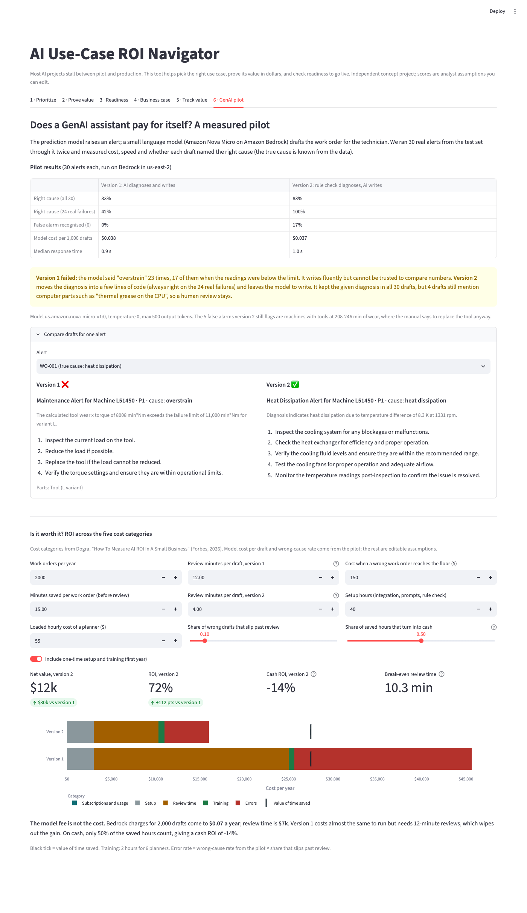
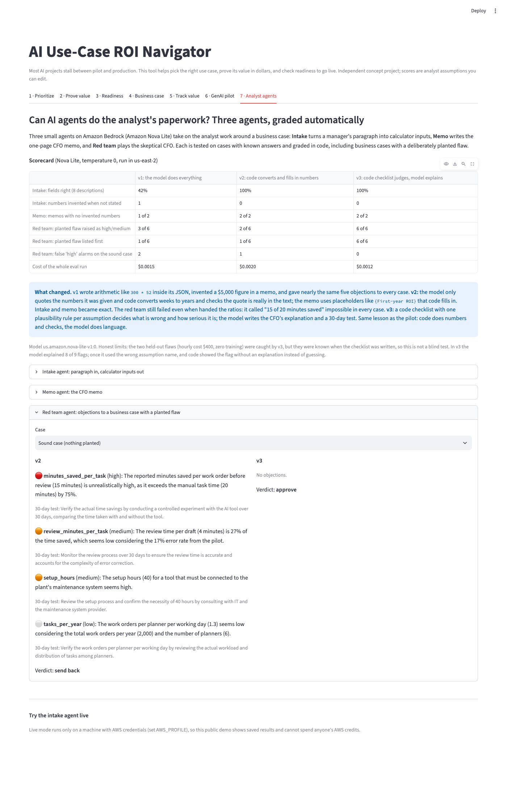

# AI Use-Case ROI Navigator

> Most teams judge AI models by accuracy. This tool judges them by dollars.

Most AI projects stall between pilot and production: companies pick projects on hype, judge models by accuracy instead of business value, and launch before they're ready. The ROI Navigator follows one project through 7 steps in three stages. It opens on an overview that tells the story in four clickable cards. Every page then follows one template: **the client view first** (the question, the answer, three numbers, one chart and what to do next), and **the analysis on demand** under *See the analysis* (assumptions, method and data), then a link to the next step:

| Step | Question it answers |
|---|---|
| **Plan · 1 · Pick a use case** | Which AI use case should we do first? Scores 12 use cases on value vs feasibility. |
| **Plan · 2 · Prove the value** | What is it worth, and how sure are we? Tunes a real predictive-maintenance model for **dollars saved, not accuracy**, with uncertainty ranges and low / base / high cases. |
| **Plan · 3 · Check readiness** | Are we ready to go live? 10-question scorecard with a Go / Fix first / Not ready verdict. |
| **Plan · 4 · Business case** | One-page summary to share with finance (downloadable). |
| **After launch · 5 · Track the value** | Is it delivering what we promised? Compares actual savings with the forecast month by month, warns when the crew stops acting on alerts or the model drifts, and explains the gap. Data arrives through an **S3 → Databricks** pipeline (bronze, silver, gold). |
| **GenAI · 6 · GenAI pilot** | Does a GenAI assistant pay for itself? A measured Amazon Bedrock pilot of an AI that drafts work orders, with ROI across five cost categories. |
| **GenAI · 7 · AI analyst agents** | Can AI agents do the analyst's paperwork? Intake, CFO-memo and red-team agents on Amazon Bedrock, each graded automatically on cases with known answers. |

*Independent concept project. Use-case scores and plant costs are illustrative assumptions and can be edited in the app.*

## Key result (default assumptions)
On 3,000 machine records the model never saw during training, a gradient-boosting model:
- catches **~86% of failures** with **~80% of alerts being real**
- yields **~$660K annual net savings** for a plant with 40 failures a year, with a **~4.7-month payback**
- **The result holds up under pessimistic assumptions.** Model uncertainty puts annual savings at **$611K–$704K** (90% range). In the low case, with every cost assumption at its unfavorable end, the project still saves **~$164K a year** and pays back in **~20 months**. The biggest driver is the cost of an unplanned failure, so that's the number to agree with finance first.
- **Forecasts need checking after launch.** In a simulated 12-month rollout the plant banks **$464K of the $660K forecast (70%)**. The Track the value page splits the $197K gap into fewer failures than assumed (−$91K), the crew ignoring correct alerts in the first months (−$63K) and model drift (−$46K), and raises a retrain alert in month 11.
- **For GenAI, the model fee is not the cost; review time is.** A 30-alert pilot on Amazon Bedrock (Nova Micro) cost **$0.04 per 1,000 drafts**. When the model diagnosed the fault itself it was right only **33%** of the time; moving the diagnosis into a rule check and letting the model only write raised that to **100% on real failures**. With 4-minute reviews the assistant returns **72% in year one**, but only **−14% in cash** if half the saved hours turn into money, and it stops paying once review takes more than **~10 minutes** a draft.
- **Agents need evals, and evals show where code beats prompts.** Three Nova Lite agents were graded on 19 cases with known answers. Version 1 got **42%** of intake fields right, invented a number in a memo and caught **3 of 6** planted flaws. Letting the model only quote numbers (code converts units and fills them into the memo) made intake and memos exact. The red team still failed until a code checklist decided what was implausible and the model only explained it: **6 of 6** flaws caught, **0** false alarms, for about **$0.001** a run.
- **The most accurate setting is not the most profitable.** Tuning the alert threshold for dollars instead of accuracy saves **~$29K more per year**, because a missed failure ($25K) costs far more than a false alarm ($500).

**Overview** (the landing page)



| Pick a use case | Prove the value |
|---|---|
|  |  |
| **Check readiness** | **Business case** |
|  |  |

**Track the value** (simulated 12-month rollout, delivered through the S3 → Databricks pipeline)



**GenAI pilot** (measured on Amazon Bedrock)



**AI analyst agents** (graded on Amazon Bedrock)



## How it works
- **Prioritization:** weighted 1–5 scores. Value = financial impact, strategic fit, scale. Feasibility = data readiness, ease of build, low risk, speed to value. Weights are adjustable.
- **Model:** AI4I 2020 dataset (10,000 records, 339 failures). Features: temperatures, speed, torque, tool wear, plus engineered power, temperature difference and wear × torque. Failure-mode columns are excluded to avoid leakage. Logistic regression (explainable baseline) vs gradient boosting; stratified 70/30 split.
- **Dollars:** test-set catch, miss and false-alarm rates are scaled to the plant's failures per year. Savings = cost of failures without AI − (planned repairs + missed failures + false alarms + running cost).
- **Uncertainty:** *model uncertainty* comes from a bootstrap of the test set (1,000 resamples, 90% range). *Assumption uncertainty* comes from a tornado chart that moves each cost input between an editable low and high value one at a time, plus low / base / high cases that set every input to its unfavorable or favorable end.
- **Value tracking:** monthly counts (alerts, failures flagged, prevented, missed, false alarms) are turned into dollars with the same formula as the forecast. Adoption = share of alerts acted on (alert below 70%). Drift = 3-month rolling recall 10+ points below launch. The gap is split by swapping each forecast assumption (failure volume, recall, share of flagged failures acted on, false alarms) for its actual value one at a time, so the parts add up exactly. The bundled 12-month rollout is simulated, not real plant data.
- **GenAI pilot:** 30 alerts from the test set (real failures of each type plus false alarms) are sent to Amazon Nova Micro on Bedrock (us-east-2, US inference profile, temperature 0, 500-token cap). Each draft must name one cause from a fixed list, graded against the true cause in the data. ROI counts the five cost categories from the Forbes article (usage, setup, review, training, errors) and splits time saved into cash and capacity. Re-run with `python -m pilot.run_pilot --profile <aws-profile> --version 2`.
- **Data pipeline:** monthly actuals files land in a private, encrypted, versioned S3 bucket (us-east-2, access logged to CloudWatch). `pipeline/run.py` syncs them into a Databricks Free Edition volume (Free Edition cannot mount your own S3; with paid Databricks this becomes a Unity Catalog external location) and runs `pipeline/notebook.py` as a serverless job: **bronze** loads files once with `COPY INTO`, **silver** applies the Track value checks and sends failing rows to **quarantine** with the reason, **gold** computes savings, adoption and drift in SQL. A unit test confirms gold matches the app's Python formula to the cent; a planted bad file is quarantined. Run with `python -m pipeline.run land sync run fetch --aws-profile <profile>`.
- **Analyst agents:** Amazon Nova Lite on Bedrock (us-east-2, temperature 0). 8 intake descriptions, 2 memos and 9 red-team cases (a sound case plus 8 with one planted flaw) live in `agents/eval_cases.json`; `python -m agents.grade` scores saved runs. The public app shows saved results; live intake runs only where AWS credentials exist.
- **Readiness:** 5 dimensions (data, workflow fit, ROI clarity, user trust, governance). Go = average ≥ 3.5 and no dimension below 2.5.

Business analysis docs (personas, use cases, 36 user stories with acceptance criteria, validation) are in [`docs/solution_design.md`](docs/solution_design.md).

## Run locally
```bash
pip install -r requirements.txt
streamlit run app.py
pytest            # optional: run the tests
```

## Data
Matzka, S. (2020). *AI4I 2020 Predictive Maintenance Dataset*. UCI Machine Learning Repository. Licensed CC BY 4.0.

## Author
Chaitali Shekar · MS Engineering Management, NC State University
