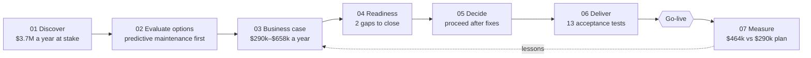
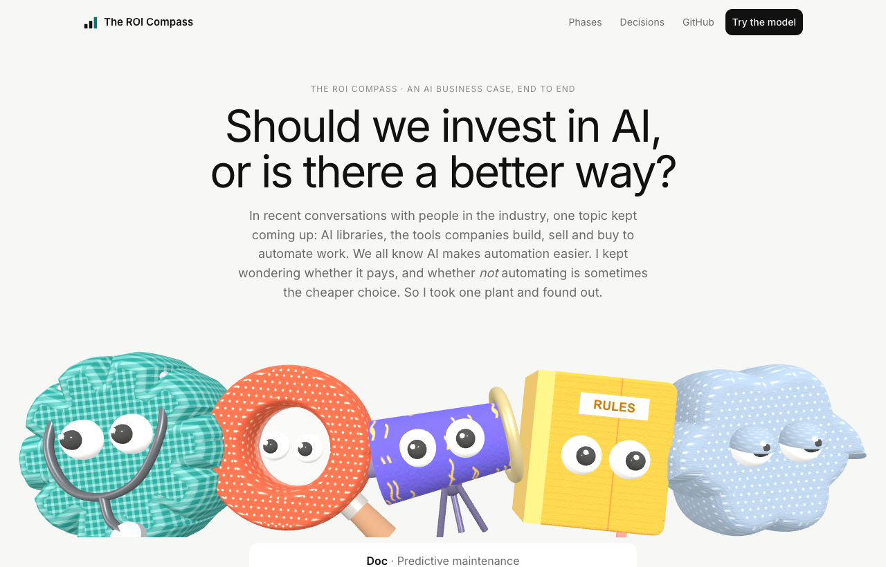
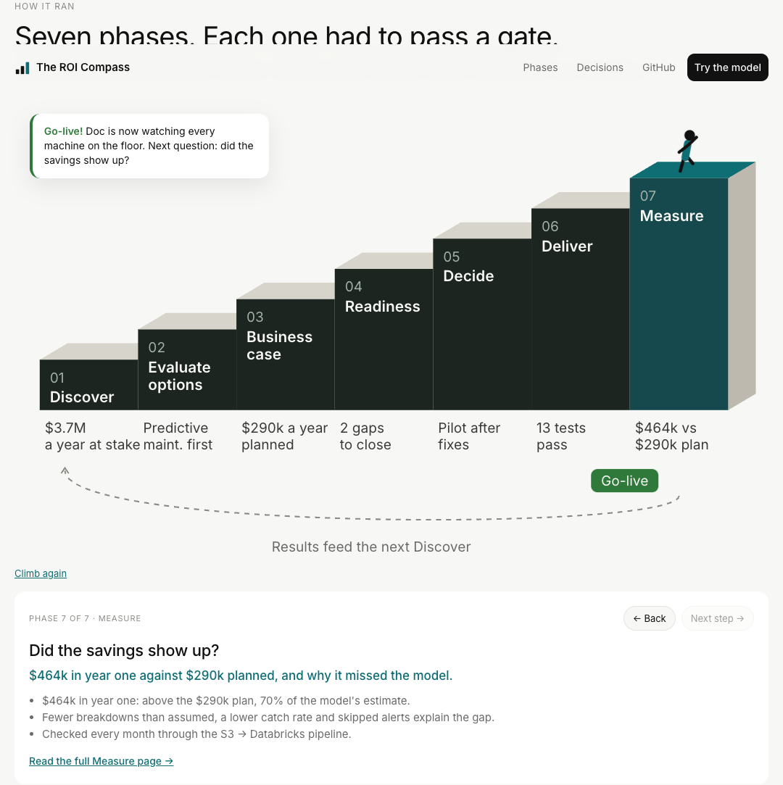
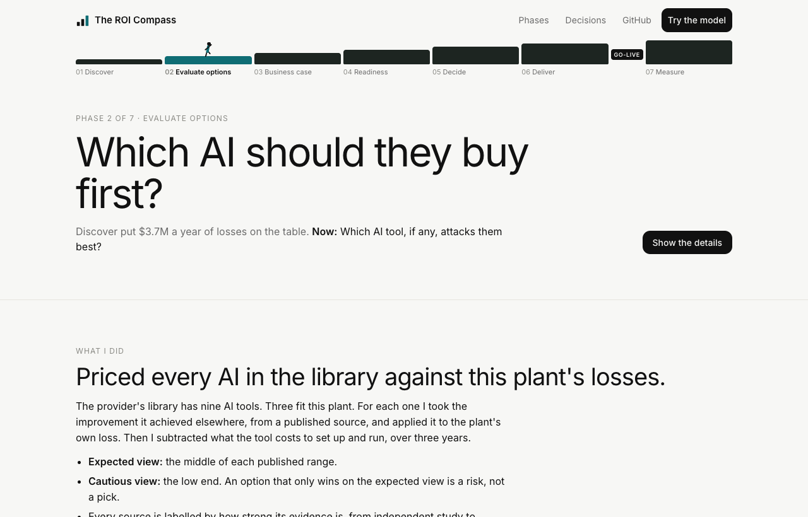
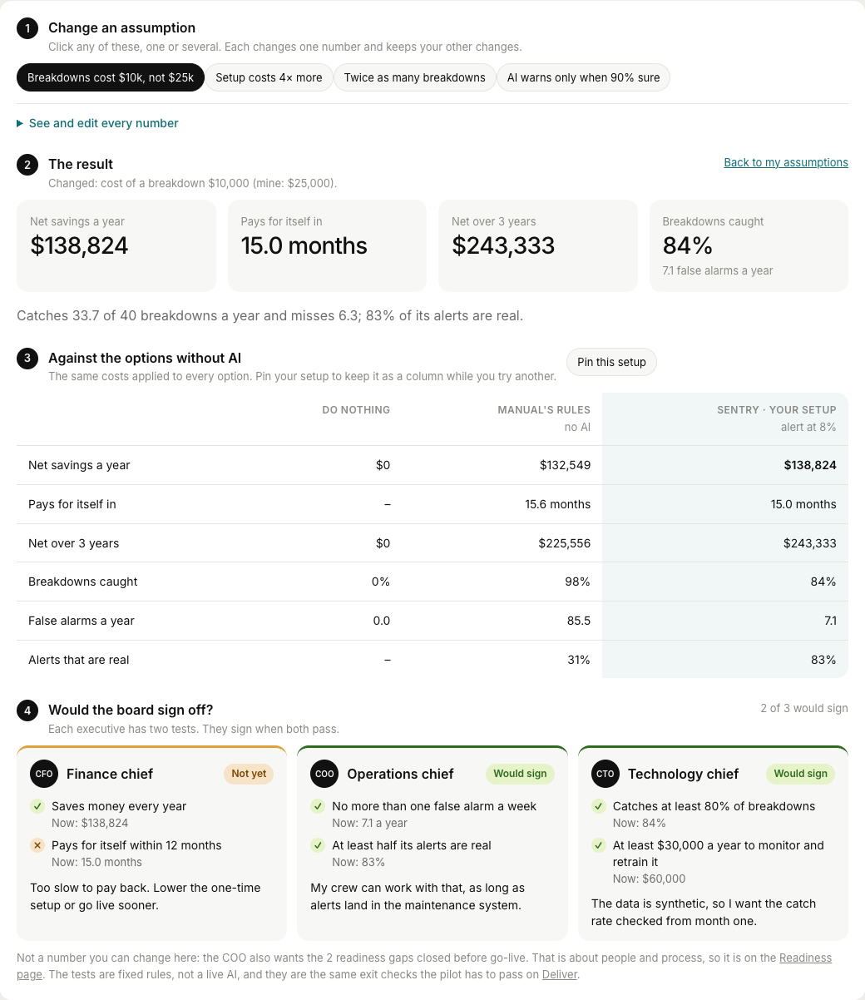
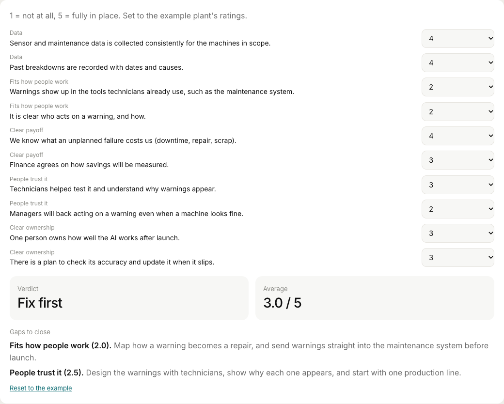
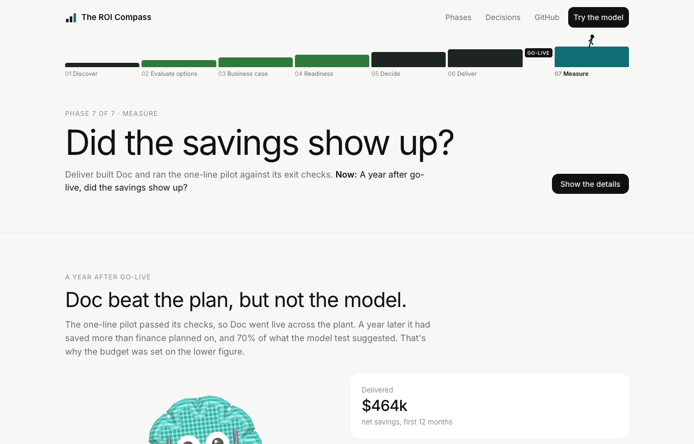
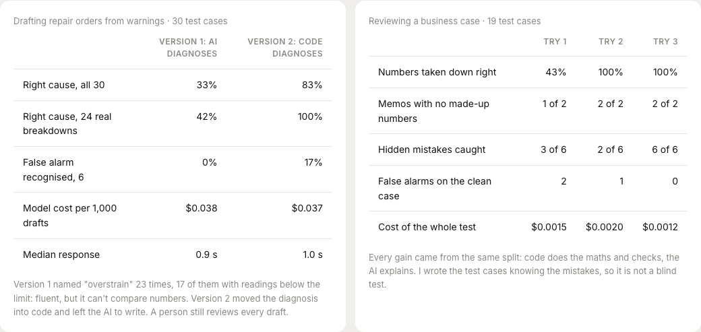

# The ROI Compass: an AI business case, end to end

> Which AI should a business buy first, and will it pay off?

[](https://chaialishekar.github.io/AI-ROI-Navigator/)


**[Open the website](https://chaialishekar.github.io/AI-ROI-Navigator/)** · **[Try the model](https://chaialishekar.github.io/AI-ROI-Navigator/phases/business-case.html#details)** · **[Read the 2-page decision brief](docs/decision_brief_sample.pdf)** · **[PRD](docs/prd.md)** · **[Architecture](ARCHITECTURE.md)**

**In one minute**
- Prices every AI tool in a provider's library for one client in dollars, with the source and strength of each number, and checks whether the order holds on cautious figures.
- Takes the top pick (predictive maintenance) through seven gated phases, from the problem to a year after go-live.
- Tests it on 10,000 public machine records: **$658k a year** on the model test, **$290k** planned on published studies, **$464k** delivered in a simulated first year.
- Compares the AI with doing nothing and with the maintenance manual's rules; the rules save more on paper but raise **~85 false alarms a year against ~13**.
- On the website, change the plant's costs and see the savings update, compare options side by side, and watch a CFO, COO and CTO react in their own words, with fixes you can try.

**Questions it answers**
- **Which AI first?** Every tool in the library, priced for one plant, on expected and cautious figures.
- **AI or a simpler option?** The AI against doing nothing and against the maintenance manual's rules, on the same costs.
- **How many false alarms is too many?** The alert level is set where an inspection pays for itself, and the site shows what moving it does to savings and to crew trust.
- **What has to be true before money is spent?** Seven phases, each with a gate: readiness gaps, a decision rule agreed in advance, a one-line pilot.
- **Did it pay off?** Twelve months tracked against the plan and the model, with the gap split by cause.

**Repository layout**
```
site/                 the website (GitHub Pages)
  index.html          home: the options, the 7-phase staircase, key decisions
  phases/             one page per phase, each with "Show the details"
  assets/             shared code (calculator, board), styles, data.js
  export_data.py      writes assets/data.js from src/
src/                  the engine: model, dollar formula, ranking, readiness, tracking, brief
data/                 AI4I 2020 records, AI library with sources, monthly actuals
pipeline/             S3 → Databricks bronze / silver / gold job
pilot/, agents/       the two Amazon Bedrock experiments and their graders
tests/                23 unit tests (pytest)
docs/                 PRD, requirements pack (13 acceptance tests), solution design, roadmap, decision brief
app.py                Streamlit analyst workbench, run locally
ARCHITECTURE.md       how it fits together
```

An end-to-end case study in **AI business systems analysis**: *should we invest in AI, or is there a better way?*

In recent conversations with people in the industry, one topic kept coming up: AI libraries, the catalogues of AI tools that companies build, sell and buy to automate work. We all know AI makes automation easier. What I kept wondering was whether it pays. Is the return higher or lower than we assume, and is *not* automating, or a simple rule, sometimes the cheaper choice? So I built a way to answer that for one specific job. I took one provider's catalogue of AI tools, priced each one for a single client, weighed it against doing nothing and against simple rules, and followed the best option through a full project lifecycle, from the business case to the savings a year after launch.

**Why this matters:** in [IBM's 2025 CEO Study](https://newsroom.ibm.com/2025-05-06-ibm-study-ceos-double-down-on-ai-while-navigating-enterprise-hurdles), only 25% of AI initiatives delivered the expected ROI, yet 65% of CEOs now pick AI use cases by ROI. [Gartner](https://www.gartner.com/en/newsroom/press-releases/gartner-survey-finds-only-22-percent-of-organizations-have-successfully-scaled-ai-across-multiple-business-units) (September 2026) found that firms which track AI ROI and drop weak projects saw positive returns on 81% of their AI initiatives. [BCG](https://www.bcg.com/press/24october2024-ai-adoption-in-2024-74-of-companies-struggle-to-achieve-and-scale-value) found AI leaders put 70% of their effort into people and processes and only 10% into algorithms. More: [PwC 2026](https://www.pwc.com/gx/en/issues/c-suite-insights/ceo-survey.html) (56% of CEOs saw no revenue or cost benefit), [McKinsey 2025](https://www.mckinsey.com/capabilities/quantumblack/our-insights/the-state-of-ai-2025) (39% report any profit impact). So the question is not whether to buy AI, but which tool first, how sure the numbers are, and how to prove it paid off.

**My role:** independent project, built end to end by me: the business analysis, the financial model, the data pipeline, the AI tests and the website.

**The library:** 9 AI tools offered across 4 industries (`data/ai_library.csv`); the case covers its manufacturing clients, an auto-parts plant and a chip fab. For each tool: how much of a problem it removed elsewhere (low to high, with the source and how strong that evidence is), the provider's price, and the data it needs. Tools are compared only for one client, on the same rules, with a cautious view that shows when a tool wins only on optimistic numbers.

**Why predictive maintenance gets the deep dive:** it ranks first for the auto-parts plant (fastest payback, and better evidence than the close runner-up), and it is the one tool that can be tested on public machine data, so its numbers can be checked, not just quoted.

**The data:** 10,000 machine records from the AI4I 2020 predictive maintenance dataset (UCI): five sensor readings (air and process temperature, rotation speed, torque, tool wear) plus product quality. 339 records (3.4%) end in a breakdown, from five causes (tool wear, heat, power, overstrain, random). The model trains on 7,000 and is tested on 3,000 it never saw. The dataset is synthetic, designed to reflect real industrial machine data.

**Real vs illustrative:** the machine data (AI4I 2020) and the model trained on it, the S3 → Databricks pipeline and the Amazon Bedrock tests are real. The improvement ranges are published results of mixed strength, labelled on every number. Client costs, provider prices and readiness ratings are example figures you can edit; the 12 months after launch are simulated.

## The project lifecycle



| Phase | Key question | Deliverable | Gate passed |
|---|---|---|---|
| **01 · Discover** | What's going wrong, and what does it cost? | Problem statement, stakeholders, as-is process map, breakdown causes in the machine data ([requirements](docs/requirements.md), [PRD](docs/prd.md)) | $3.7M a year at stake across three problems |
| **02 · Evaluate options** | Which AI tool should they buy first? | Every tool for the client's industry priced in their dollars over 3 years: published improvement ranges with sources, evidence labels, expected and cautious views, extra cost for data gaps, break-even | Predictive maintenance first for the auto-parts plant. For the chip fab, the expected favourite (yield optimization) rests on a vendor claim and drops to third on cautious numbers, so I'd pilot it first |
| **03 · Business case** | Will it pay for itself, and how sure are we? | Savings calculation line by line, payback, 3-year ROI, break-even, ranges, sensitivity; priced against doing nothing and against the maintenance manual's rules. The warning level is set at **break-even from the costs**, not tuned on the test data, and saves more than the most accurate setting | $290k a year on published figures, $658k on the model test; the budget is approved on the lower one |
| **04 · Readiness** | Can the team actually use it? | 10 questions in 5 areas, stakeholder impact, human review and escalation rules, to-be process map | Two gaps to close before launch |
| **05 · Decide** | What exactly is finance signing? | A decision rule agreed up front and a two-page **decision brief (PDF)** with options, ranges, risks with owners and decision gates | Proceed after fixes |
| **06 · Deliver** | What gets built, and how do we know it works? | Integration spec, data dictionary, 13 acceptance tests and a traceability matrix ([requirements](docs/requirements.md)) | All 13 acceptance tests pass |
| **07 · Measure** | Did the savings show up? | Forecast vs actual each month, the causes of any shortfall, alerts when the crew ignores warnings or the AI gets weaker; data arrives through an **S3 → Databricks** pipeline | $464k in year 1 against the $290k plan, 70% of the model's estimate (simulated), with the reasons |

**Side experiments** (separate from the main case: the breakdown warnings come from a *predictive* model; these test *generative* AI that writes text):

| Experiment | Question | What was measured |
|---|---|---|
| **A · GenAI work orders** | Can GenAI turn a warning into an accurate draft work order? | 30 warnings (24 real breakdowns, 6 false alarms) on Amazon Bedrock, graded against the true cause; right cause on 10 of 24 breakdowns when the model diagnosed, 24 of 24 when rules diagnosed and it only wrote. A planner still reviews every draft. |
| **B · GenAI business-case review** | Can GenAI flag errors in a business case? | Three AI helpers tested on 19 cases with known answers; the critic caught 6 of 6 seeded errors in its final version. Small and not blind: I wrote the test cases. |

Every page shows **the answer first** (the question, the answer, three numbers, one chart, what to do next) and **the details on demand** under *Show the details*.

## Analysis documents

| Document | What is in it |
|---|---|
| [Product requirements document (PRD)](docs/prd.md) | Start here: problem and evidence, goals and non-goals, users, as-is / to-be for the purchase decision, prioritised user stories, success metrics, risks, alternatives considered, launch plan |
| [Executive decision brief (sample PDF)](docs/decision_brief_sample.pdf) | Two-page investment brief generated in the Decide phase: recommendation, options, savings calculation, risks, decision gates |
| [Requirements pack](docs/requirements.md) | Process maps today and with AI, integration spec (warning → work order), data dictionary, 13 user acceptance tests, requirements traceability matrix |
| [Solution design](docs/solution_design.md) | Stakeholders, use cases, 36+ user stories with acceptance criteria and MoSCoW priorities, fishbone of why value falls short, RACI |
| [Roadmap](docs/roadmap.md) | Now / Next / Later, prioritised by value × ease |
| [Delivery log](docs/delivery.md) | How the work was split into increments and checked |

*Independent concept project. Client costs and provider prices are illustrative and can be edited on the website's Business case page; improvement ranges are published results with sources.*

## Key result (default assumptions)
On 3,000 machine records the model never saw during training, a gradient-boosting model:
- alerts at the **break-even level** set by the costs ($500 inspection ÷ ($21K saved per early catch + $500) ≈ 2%), so the test set is used only to check the result, never to tune it
- catches **~86% of failures** with **~73% of alerts being real** (~13 false alarms a year)
- yields **~$658K annual net savings** for a plant with 40 failures a year, with a **~4.7-month payback**
- **Plan with the published figure.** Published studies (20–50% less downtime) give **~$290K a year** for the same plant. The model test is higher because the synthetic data makes breakdowns easier to predict, so the case approves on the published figure and treats the rest as upside to prove in the pilot.
- **The result holds up under pessimistic assumptions.** Model uncertainty puts annual savings at **$609K–$703K** (90% range). In the low case, with every cost assumption at its unfavorable end, the project still saves **~$164K a year** and pays back in **~21 months**. The biggest driver is the cost of an unplanned failure, so that's the number to agree with finance first.
- **Forecasts need checking after launch.** After the one-line pilot passes, the AI goes live across the plant. In a simulated first year it banks **$464K: above the $290K plan finance approved, but 70% of the model's $658K estimate**, which is why the budget was set on the lower figure. The Measure phase splits the $195K gap to the model into fewer failures than assumed (−$91K), the crew ignoring correct alerts in the first months (−$63K) and model drift (−$46K), and raises a retrain alert in month 11 after go-live.
- **For GenAI, the model fee is not the cost; review time is.** A 30-alert pilot on Amazon Bedrock (Nova Micro) cost **$0.04 per 1,000 drafts**. When the model diagnosed the fault itself it was right only **33%** of the time; moving the diagnosis into a rule check and letting the model only write raised that to **100% on the 24 true failures** in these 30 examples (a small synthetic sample, not proof for a live plant). With 4-minute reviews the assistant returns **72% in year one**, but only **−14% in cash** if half the saved hours turn into money, and it stops paying once review takes more than **~10 minutes** a draft.
- **Agents need evals, and evals show where code beats prompts.** Three Nova Lite agents were graded on 19 cases with known answers. Version 1 got **42%** of intake fields right, invented a number in a memo and caught **3 of 6** planted flaws. Letting the model only quote numbers (code converts units and fills them into the memo) made intake and memos exact. The red team still failed until a code checklist decided what was implausible and the model only explained it: **6 of 6** flaws caught, **0** false alarms, for about **$0.001** a run.
- **Simple rules look as good as the AI here, and the reason matters.** Alerts built from the maintenance manual's limits catch 98% of breakdowns and save ~$721K, more than the AI's $658K, because AI4I 2020 is synthetic and its failures were generated from those same limits. They also raise **~85 false alarms a year against the AI's ~13** (31% of their alerts are real vs 73%), and crew trust is already the weakest readiness area. The case recommends the AI, keeps the manual's limits to explain each warning, and makes "pilot on one line and measure false alarms" a gate before scaling.
- **The most accurate setting is not the most profitable.** Alerting at the cost break-even level instead of the usual 50% cut-off saves **~$20K more per year**, because a missed failure ($25K) costs far more than a false alarm ($500).

**The website** ([open it](https://chaialishekar.github.io/AI-ROI-Navigator/))



| Seven phases, one gate each | Every option priced for one plant |
|---|---|
|  |  |

**The model you can change**, with the options side by side and the board's reactions (Business case → Show the details)



| Readiness, rated live | A year after go-live |
|---|---|
|  |  |

**The GenAI experiments, scored** (Deliver → Show the details)



## How it works
- **Library ranking:** value a year = client's problem cost × published improvement (low / middle / high); net = value − running cost; 3-year net value = net × live months ÷ 12 − setup; each point of missing data quality adds 20% to setup and 2 months. Ranked on the middle (expected) or low end (cautious); a runner-up within 25% is flagged as a close call. Code: `src/library.py`.
- **Model:** AI4I 2020 dataset (10,000 records, 339 failures). Features: temperatures, speed, torque, tool wear, plus engineered power, temperature difference and wear × torque. Failure-mode columns are excluded to avoid leakage. Logistic regression (explainable baseline) vs gradient boosting; stratified 70/30 split. The dataset's failures were generated from rules on power, temperature difference and wear × torque, so these features make the test AUC (0.99) an upper bound, not what a real plant would see.
- **Dollars:** test-set catch, miss and false-alarm rates are scaled to the plant's failures per year. Savings = cost of failures without AI − (planned repairs + missed failures + false alarms + running cost).
- **Uncertainty:** *model uncertainty* comes from a bootstrap of the test set (1,000 resamples, 90% range). *Assumption uncertainty* comes from a tornado chart that moves each cost input between an editable low and high value one at a time, plus low / base / high cases that set every input to its unfavorable or favorable end.
- **Value tracking:** monthly counts (alerts, failures flagged, prevented, missed, false alarms) are turned into dollars with the same formula as the forecast. Adoption = share of alerts acted on (alert below 70%). Drift = 3-month rolling recall 10+ points below launch. The gap is split by swapping each forecast assumption (failure volume, recall, share of flagged failures acted on, false alarms) for its actual value one at a time, so the parts add up exactly. The bundled 12-month rollout is simulated, not real plant data.
- **GenAI pilot:** 30 alerts from the test set (true failures of each type plus false alarms, from the synthetic dataset) are sent to Amazon Nova Micro on Bedrock (us-east-2, US inference profile, temperature 0, 500-token cap). Each draft must name one cause from a fixed list, graded against the true cause in the data. ROI counts the five cost categories from the Forbes article (usage, setup, review, training, errors) and splits time saved into cash and capacity. Re-run with `python -m pilot.run_pilot --profile <aws-profile> --version 2`.
- **Data pipeline:** monthly actuals files land in a private, encrypted, versioned S3 bucket (us-east-2, access logged to CloudWatch). `pipeline/run.py` syncs them into a Databricks Free Edition volume (Free Edition cannot mount your own S3; with paid Databricks this becomes a Unity Catalog external location) and runs `pipeline/notebook.py` as a serverless job: **bronze** loads files once with `COPY INTO`, **silver** applies the Track value checks and sends failing rows to **quarantine** with the reason, **gold** computes savings, adoption and drift in SQL. A unit test confirms gold matches the app's Python formula to the cent; a planted bad file is quarantined. Run with `python -m pipeline.run land sync run fetch --aws-profile <profile>`.
- **Analyst agents:** Amazon Nova Lite on Bedrock (us-east-2, temperature 0). 8 intake descriptions, 2 memos and 9 red-team cases (a sound case plus 8 with one planted flaw) live in `agents/eval_cases.json`; `python -m agents.grade` scores saved runs. The website shows the saved, graded results; live runs need AWS credentials (`streamlit run app.py`).
- **Readiness:** 5 areas (data, fits how people work, clear payoff, people trust it, clear ownership). Go = average ≥ 3.5 and no dimension below 2.5.

## Run locally
```bash
pip install -r requirements.txt
streamlit run app.py               # the analyst workbench, including live Bedrock runs
python site/export_data.py         # refresh the website's numbers from src/
python -m http.server -d site 8000 # view the website
pytest                             # optional: run the tests
```

## Data
Matzka, S. (2020). *AI4I 2020 Predictive Maintenance Dataset*. UCI Machine Learning Repository. Licensed CC BY 4.0.

## Author
Chaitali Shekar · MS Engineering Management, NC State University


## How it was managed

User stories with acceptance criteria and MoSCoW priorities, a fishbone of why value falls short, a RACI for who owns what after launch, and a log of the delivery increments: [docs/solution_design.md](docs/solution_design.md) and [docs/delivery.md](docs/delivery.md).
