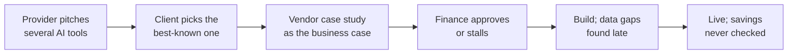
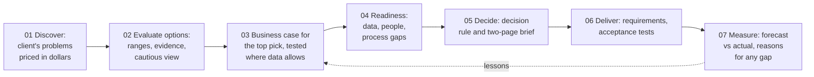

# PRD: AI ROI Navigator

> Pick the right AI first, and prove it paid off.

| | |
|---|---|
| **Author** | Chaitali Shekar, AI business systems analyst |
| **Status** | v1 built and live; v2 scoped ([roadmap](roadmap.md)) |
| **Reviewers (personas)** | Operations director, finance partner, AI provider's client team |
| **Detail behind this PRD** | [Requirements pack](requirements.md) (process maps, integration spec, data dictionary, acceptance tests, traceability) · [Full backlog and design](solution_design.md) · [Delivery log](delivery.md) |

---

## 1. TL;DR

An AI provider sells a library of AI tools. Its clients keep asking two questions: **which one should we buy first, and will it actually pay off?** Today the answer comes from vendor slides with best-case numbers. The Navigator prices every tool that fits a client in that client's own dollars, labels how strong the evidence is behind each number, and shows whether the order still holds on cautious figures. It then takes the top pick through a full business case, a readiness check, a sign-off brief and monthly tracking after launch.

---

## 2. Problem

**Who has it:** operations leaders at manufacturers deciding which AI to buy, and the providers selling to them.

**What happens today**

| Step | Today | Consequence |
|---|---|---|
| Shortlist | The provider pitches several tools; the client picks the most talked-about | Popular is not the same as profitable |
| Business case | Vendor-paid studies with best-case ROI; no ranges, no source quality | Finance cannot tell a strong number from a hopeful one |
| Data and people | Data gaps and workflow changes found after signing | Projects stall between pilot and production |
| After launch | Nobody checks savings against the promise | Weak projects keep their budget; strong ones are not scaled |

**Evidence that this is widespread** (each checked against the publisher's page)

| Source | Finding |
|---|---|
| [IBM CEO Study, 2025](https://newsroom.ibm.com/2025-05-06-ibm-study-ceos-double-down-on-ai-while-navigating-enterprise-hurdles) (2,000 CEOs) | Only 25% of AI initiatives delivered the expected ROI; 65% of CEOs now pick AI use cases based on ROI |
| [PwC 29th Global CEO Survey, 2026](https://www.pwc.com/gx/en/issues/c-suite-insights/ceo-survey.html) (4,454 CEOs) | 56% saw neither higher revenue nor lower costs from AI |
| [McKinsey State of AI, 2025](https://www.mckinsey.com/capabilities/quantumblack/our-insights/the-state-of-ai-2025) | 39% report any profit (EBIT) impact from AI |
| [BCG, Where's the Value in AI?, 2024](https://www.bcg.com/press/24october2024-ai-adoption-in-2024-74-of-companies-struggle-to-achieve-and-scale-value) (1,000 executives) | 74% have yet to show tangible value; leaders put 70% of effort into people and processes, 10% into algorithms |
| [Gartner, September 2026](https://www.gartner.com/en/newsroom/press-releases/gartner-survey-finds-only-22-percent-of-organizations-have-successfully-scaled-ai-across-multiple-business-units) (1,303 leaders) | Firms that track AI ROI and drop weak projects see positive returns on 81% of initiatives; the most popular AI uses rarely return the most |

**Why now:** AI budgets keep growing while most buyers cannot show a return. The firms that do well are the ones that measure, which is a process and analysis gap more than a technology gap.

---

## 3. Goals and non-goals

**Goals**
1. A client can see, in one view, which AI tool to buy first and why, in their own dollars.
2. Every number says where it came from and how far to trust it.
3. A tool cannot come first on optimistic numbers alone without that being visible.
4. The top pick has a business case finance can approve, with a stated decision rule.
5. After launch, savings are checked against the forecast every month, with the reason for any gap.

**Non-goals (v1)**
- Comparing industries against each other. Tools are only compared for one client.
- Picking a single winner. The ranking is an order of priority; tools fix different problems.
- Vendor or model selection for the same use case (which predictive maintenance product to buy).
- Real provider prices or real client data. Both are editable example figures in v1.
- A deep dive for every tool. v1 works one tool (predictive maintenance) through in full.

---

## 4. Users

| Persona | Job to be done | What they need from the product |
|---|---|---|
| **Operations director** (primary) | "Decide which AI to buy first and defend it to my CFO." | Dollars, payback and a clear first pick; plain language |
| **Finance partner** | "Approve only what will pay back, and know how sure we are." | Ranges, sources, a cautious view, break-even, a decision rule |
| **AI provider's client team** | "Show each client honestly which tool pays off first, so they renew." | A shareable comparison and brief that hold up to scrutiny |
| **AI business systems analyst** (operator) | "Run the session, tailor the figures, explain the result." | Editable inputs, the method on demand, the documents behind it |

---

## 5. As-is and to-be: how an AI purchase is decided

**As-is**

**To-be (with the Navigator)**

| Change | Effect |
|---|---|
| Problems priced before tools are discussed | The conversation starts from the client's money, not the vendor's catalogue |
| Published ranges with evidence labels replace a single vendor figure | Weak numbers are visible before they are approved |
| Data gaps priced up front (+20% setup and +2 months per point short) | Fewer surprises after signing |
| Decision rule agreed before results are seen | Approval does not depend on who argues best |
| Monthly forecast-vs-actual | Weak projects are fixed or stopped; strong ones are scaled |

The shop-floor process the top pick changes (from machine warning to planned repair) is mapped in the [requirements pack, section 2](requirements.md#2-process-map-from-warning-to-repair-today-and-with-ai).

---

## 6. User stories (prioritised)

P0 = must have for v1, P1 = should have. Full backlog with every acceptance criterion: [solution_design.md §3.2](solution_design.md).

| ID | Priority | As a… | I want… | So that… | Acceptance criteria | Status |
|---|---|---|---|---|---|---|
| US-1.1 | P0 | Operations director | every AI tool for my industry priced in my dollars | I know which to buy first | Value = problem cost × published improvement; 3-year net, payback, ROI, break-even; matches a hand calculation | Done |
| US-1.3 | P0 | Finance partner | each number as a range with its source | I can judge how far to trust it | Low / expected / high; evidence label and link on every row | Done |
| US-1.5 | P0 | Analyst | missing data to cost extra | tools needing perfect data do not look unfairly good | +20% setup and +2 months per point short; unit test | Done |
| US-1.7 | P0 | Finance partner | to see if the order holds on cautious numbers | no tool wins on optimism alone | Expected / cautious switch; rank changes listed; unit test | Done |
| US-1.6 | P0 | Business sponsor | to know why a tool is first, and when it is a close call | I can challenge it | Names value, payback and evidence; flags a runner-up within 25% | Done |
| US-2.2 | P0 | Operations director | the top pick's savings in dollars from a real test | the case rests on more than published figures | Catch, miss and false-alarm rates from held-out data turned into dollars | Done |
| US-2.9 | P0 | Finance partner | the AI compared with doing nothing and with simple rules | we do not buy AI where rules would do | Both alternatives priced on the same data | Done |
| US-3.1 | P0 | Operations director | a readiness verdict with the gaps to close | the pilot does not stall | Go / fix first / not ready, top actions, owners | Done |
| US-4.1 | P0 | Finance partner | a two-page brief with a decision rule | I can approve or stop it | PDF: recommendation, options, ranges, risks, gates, evidence | Done |
| US-6.1 | P0 | Operations director | savings tracked against the forecast every month | I know whether it paid off | Gap split into causes that add up exactly; adoption and drift alerts | Done |
| US-1.2 | P1 | Operations director | to enter my own costs, data quality and sites | the numbers are mine | Editable; ranking updates at once | Done |
| US-1.4 | P1 | Operations director | a next step for the top pick | I know what to do | Links to the business case; recommends a pilot first when evidence is weak | Done |

---

## 7. Requirements

**Functional:** covered by the stories above; each P0 story traces to code, an automated test and an acceptance test in the [traceability matrix](requirements.md#6-requirements-traceability-matrix).

**Non-functional**

| Area | Requirement |
|---|---|
| Clarity | Every page answers its question in the first screen; the method sits under "Show the details" |
| Honesty | Every headline number is labelled: published, measured, assumption or simulated |
| Consistency | One formula for every tool; one 3-year window; same cost treatment |
| Responsiveness | Works at phone width with no sideways scroll |
| Reliability | All pages load with default inputs; automated tests pass before each release |
| Safety | No live AI calls or credentials in the public demo |

---

## 8. Success metrics

v1 is a case study, so these are the targets a provider would track in a pilot with real clients, not results.

| Metric | Type | Target |
|---|---|---|
| Time from a vendor pitch to a priced shortlist | Speed | Under 1 hour (today: weeks of back-and-forth) |
| Share of first picks whose evidence is "medium" or stronger | Quality | 80%+ |
| Business cases approved without a request for more numbers | Adoption | 70%+ |
| Projects reaching at least 90% of forecast savings by month 6 | Outcome | 60%+, against the 25% in IBM's study |
| Projects stopped or fixed within 3 months of falling behind | Outcome | 100% flagged by the monthly check |

---

## 9. Assumptions, risks and open questions

| Item | Type | Mitigation |
|---|---|---|
| Published improvement ranges come from mixed sources (one peer-reviewed field study, several vendor claims) | Risk | Evidence label on every number; cautious view; pilot first when the top pick rests on a vendor claim |
| Provider prices and client costs are examples | Assumption | Editable; replaced with the client's own figures in a real session |
| The deep-dive dataset is synthetic, so the model looks better than it would in a plant | Risk | The case plans on the published figure ($290k a year), not the test ($660k); a pilot gate measures the real rate |
| Tools are ranked as alternatives but may be bought together | Risk | Framed as an order of priority, not a winner |
| Should budget limits be an input (best set of tools within $X)? | Open question | Candidate for v2 |
| Which tool gets the second deep dive? | Open question | Visual inspection (close runner-up) or yield optimization (to test the vendor claim) |

---

## 10. Alternatives considered

| Option | Why not chosen |
|---|---|
| Weighted 1–5 scoring matrix (value × ease) | Used in an earlier version. Scores are hard to defend to finance and hide where the numbers came from; replaced by dollars with ranges |
| A single ROI figure per tool | Hides uncertainty; a tool with a vendor's best case beats a well-evidenced one |
| Comparing across industries | Not a fair comparison: a factory cannot buy fraud detection |
| Vendor-commissioned ROI studies as inputs | Built to sell; used only as a labelled, low-trust source |

---

## 11. Launch plan

| Phase | Scope | Exit criterion |
|---|---|---|
| v1 (done) | Library comparison for manufacturing clients; predictive maintenance deep dive; readiness, brief, tracking | Hand-calculation tests pass; all pages load; phone layout checked |
| Pilot | One provider, three real clients, real prices and problem costs | Shortlist in under 1 hour; finance accepts the brief format |
| v2 | Second deep dive; budget-constrained portfolio view; more industries with stronger sources | Evidence for each new entry at "medium" or stronger |

---

## Appendix: where each BA deliverable lives

| Deliverable | Location |
|---|---|
| Problem statement, goals, personas, prioritised stories, metrics | This PRD |
| As-is / to-be (purchase decision) | This PRD §5 |
| As-is / to-be (shop floor), integration spec, data dictionary | [requirements.md](requirements.md) |
| Acceptance tests and traceability matrix | [requirements.md §5–6](requirements.md#5-user-acceptance-tests) |
| Full backlog (36+ stories, MoSCoW), fishbone, RACI, architecture | [solution_design.md](solution_design.md) |
| Roadmap | [roadmap.md](roadmap.md) |
| Sample decision brief | [decision_brief_sample.pdf](decision_brief_sample.pdf) |
