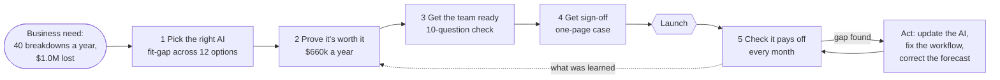
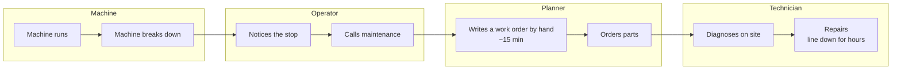
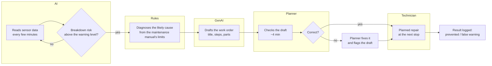

# Requirements pack

*Business systems analysis for the example: a mid-size factory using AI to warn before machines break down.*
User stories with acceptance criteria and MoSCoW priorities are in [solution_design.md](solution_design.md) §3.2;
this pack adds what a delivery team needs to build and test it.

1. [How the whole project runs](#1-how-the-whole-project-runs)
2. [Process map: from warning to repair, today and with AI](#2-process-map-from-warning-to-repair-today-and-with-ai)
3. [Integration spec: warning → work order](#3-integration-spec-warning--work-order)
4. [Data dictionary](#4-data-dictionary)
5. [User acceptance tests](#5-user-acceptance-tests)
6. [Requirements traceability matrix](#6-requirements-traceability-matrix)

---

## 1. How the whole project runs

## 2. Process map: from warning to repair, today and with AI

The readiness check scored **"Fits how people work"** lowest (2.0 / 5): the AI's warnings did not reach the people
who fix machines. These maps show the gap and the fix.

**Today (as-is):** repairs start after a machine breaks.

**With AI (to-be):** the AI warns before the breakdown and the work order arrives pre-filled.

| Change | Today | With AI | Owner (see RACI, solution_design.md §6.2) |
|---|---|---|---|
| When the repair starts | After the breakdown | Before it, at a planned stop | Maintenance manager |
| Who diagnoses | Technician, on site | Rules from the manual, before anyone arrives | Data / IT lead keeps the rules current |
| Work order | Written by hand, ~15 min | Drafted by AI, checked in ~4 min | Planner |
| Record of the outcome | Breakdown logged | Every warning logged as prevented, missed or false | Planner, sent monthly by Data / IT |

## 3. Integration spec: warning → work order

How a warning becomes a work order in the plant's maintenance system (a CMMS such as SAP PM or IBM Maximo).

**Trigger:** the AI's breakdown risk for a machine is at or above the warning level (0.05 at the default costs,
chosen to save the most money, see step 2).

**Flow:**
1. The AI service sends a warning event.
2. The rule check adds the likely cause, or "unclear: inspect" if no manual limit is broken.
3. The writing assistant drafts the work order text.
4. The maintenance system creates a **draft** work order. It is never released without a planner's approval.
5. The planner approves, edits or rejects it. The decision is sent back and logged.

**Warning event (AI → integration)**

| Field | Type | Required | Example | Rule |
|---|---|---|---|---|
| warning_id | text | yes | `W-2026-11-0042` | Unique; repeats of the same ID are ignored |
| machine_id | text | yes | `M-117` | Must exist in the maintenance system's asset list |
| raised_at | timestamp (UTC) | yes | `2026-11-03T14:20:00Z` | |
| risk | number 0–1 | yes | `0.31` | At or above the warning level |
| readings | object | yes | air and process temperature, rpm, torque, tool wear | Values as read, in the manual's units |
| likely_cause | text | yes | `overstrain` | From the rule check: power, overstrain, heat dissipation, tool wear, or unclear |
| cause_reason | text | yes | `wear x torque 13,100 exceeds the 13,000 limit` | Plain sentence a planner can check |

**Draft work order (integration → maintenance system)**

| Field | Source | Rule |
|---|---|---|
| title, steps, parts | Writing assistant | Must keep the rule check's cause; parts from the plant's catalogue only |
| priority | Rule | High if risk ≥ 0.5, otherwise medium |
| status | Fixed | `Draft: awaiting planner` |
| link_to_warning | warning_id | Kept for the monthly results file |

**Errors and fallbacks**

| Situation | What happens | Who is told |
|---|---|---|
| Unknown machine_id | Warning held, not dropped | Data / IT lead, same day |
| Writing assistant unavailable or slow (>30 s) | Work order created with the rule check's cause and a blank text for the planner | Planner sees "draft text unavailable" |
| Draft mentions a part not in the catalogue | Part removed, flagged in the draft | Planner |
| Same machine warned twice within 24 h | Second warning added to the open draft, no new order | n/a |

**Monthly results file (maintenance system → app):** one row per month, fields in §4.2. Sent by the 2nd of each
month to the secure S3 landing zone.

## 4. Data dictionary

### 4.1 AI options (`data/use_cases.csv`)

| Field | Meaning | Values |
|---|---|---|
| use_case | Name of the AI option | text |
| industry | Industry it was first built for | Manufacturing, Retail, Healthcare |
| description | What it does, in one sentence | text |
| serves | Industries it can be used in | `;`-separated list |
| solves | The business problem it addresses | e.g. Unplanned downtime |
| financial_impact, strategic_fit, scale | Value scores | 1–5, 5 is better |
| data_readiness, ease_of_build, low_risk, speed_to_value | Ease scores (low_risk 5 = little harm if the AI is wrong) | 1–5, 5 is better |

### 4.2 Monthly results file (sent by the plant)

| Field | Meaning | Rule |
|---|---|---|
| month | Calendar month | `YYYY-MM`, once per file |
| alerts_raised | Warnings the AI sent | whole number ≥ 0 |
| failures_flagged | Breakdowns the AI warned about in advance, acted on or not | ≤ failures_prevented + failures_missed |
| failures_prevented | Warned breakdowns fixed in time | ≤ failures_flagged |
| failures_missed | Breakdowns that happened anyway (not warned, or warned but ignored) | ≥ 0 |
| false_alarms | Inspections that found nothing wrong | prevented + false_alarms ≤ alerts_raised |

A file that breaks any rule is set aside with the reason (`quarantine_actuals`), not loaded.

### 4.3 Final monthly numbers (`gold_tracked_value`, exported to the app)

| Field | Meaning | Formula |
|---|---|---|
| failures | All breakdowns that month | prevented + missed |
| acted_on | Warnings the crew acted on | prevented + false_alarms |
| recall | Share of breakdowns the AI warned about | flagged ÷ failures |
| adoption | Share of warnings the crew acted on | acted_on ÷ alerts_raised |
| recall_3m | Recall over the last 3 months | Σ flagged ÷ Σ failures, 3 months |
| forecast | Savings promised for the month | annual savings in the business case ÷ 12 |
| actual | Savings delivered | prevented × (cost of a breakdown − cost of a planned repair) − false_alarms × cost of an inspection − running cost ÷ 12 |
| cum_forecast, cum_actual | Running totals since launch | |
| adoption_alert | Crew acted on fewer than 70% of warnings | adoption < 0.70 |
| drift_alert | AI is getting worse | recall_3m < launch recall − 10 points |
| source_file | File the row came from | for tracing back to the plant |

## 5. User acceptance tests

Written for business users. Each is run in the app by the named role before sign-off.

| ID | Role | Given | When | Then | Story | Result |
|---|---|---|---|---|---|---|
| UAT-01 | Ops director | The factory profile is selected | I open step 1 | Predictive maintenance is recommended, with the reason "solves their main problem" | US-1.5, US-1.6 | Pass |
| UAT-02 | Ops director | I describe my own business as Manufacturing with quality defects | I look at the recommendation | Visual quality inspection is recommended | US-1.5 | Pass |
| UAT-03 | Finance partner | Default costs | I open step 2 | Yearly savings, payback and a worst-case figure are shown, and the worst case is still positive | US-2.2, US-2.8 | Pass |
| UAT-04 | Finance partner | I raise the cost of a breakdown to $40,000 | I return to step 4 | The one-page case shows the new savings without re-entering anything | US-4.1 | Pass |
| UAT-05 | Maintenance manager | The example ratings | I open step 3 | The verdict is "Fix first", and the top action is about getting warnings into the maintenance system | US-3.2 | Pass |
| UAT-06 | Planner | A monthly file where prevented is larger than flagged | I upload it on step 5 | The file is refused with the reason in plain words, and nothing is added to the totals | US-6.1, US-9.2 | Pass |
| UAT-07 | Ops director | 12 months of results | I open step 5 | I see the share of the promise delivered, the biggest reason for the gap, and what to do next | US-6.1 | Pass |
| UAT-08 | Data / IT lead | The AI's catch rate falls 10+ points below launch | The month is loaded | Step 5 says to update the AI with recent data | US-6.3 | Pass |
| UAT-09 | Planner | Warning case 17 | I compare drafts on step 6 | The try-2 draft names the same cause as the rule check | US-7.4 | Pass |
| UAT-10 | Finance partner | A business case with a hidden mistake (hourly cost $400) | I open the critic on step 7 | The hourly cost is listed first as a serious issue | US-8.3 | Pass |
| UAT-11 | Any visitor | No AWS credentials | I open step 7 | Saved results are shown and the live AI cannot be called | US-8.5 | Pass |
| UAT-12 | Any visitor | A phone-sized screen | I open the overview | The process chart stacks top to bottom and every step can be opened | NFR Clarity | Pass |

## 6. Requirements traceability matrix

Every Must story, where it is built, how it is tested and the result. Should and Could stories are in
[solution_design.md](solution_design.md) §3.2.

| Requirement | Built in | Automated test | Acceptance test | Result |
|---|---|---|---|---|
| US-1.1 Rank options by value and ease | `src/scoring.py` | `test_scoring_matches_hand_calculation` | n/a | Pass |
| US-1.5 Match options to the business need | `src/matching.py`, step 1 | `test_matching_recommends_by_client`, `test_matching_data_maturity_lowers_feasibility` | UAT-01, UAT-02 | Pass |
| US-1.6 Explain why an option was picked | `src/matching.py` `reasons()` | `test_matching_recommends_by_client` | UAT-01 | Pass |
| US-2.2 Savings in dollars | `src/value.py` `evaluate()` | `test_value_math` | UAT-03 | Pass |
| US-2.3 Warning level set for money, not accuracy | `src/value.py` `sweep()`, step 2 | Validation table, solution_design.md §8 | UAT-03 | Pass |
| US-2.7 / 2.8 Ranges and best / worst case | `src/value.py` `bootstrap()`, `scenarios()` | `test_bootstrap_range_contains_point_estimate`, `test_sensitivity_and_scenarios_are_ordered` | UAT-03 | Pass |
| US-3.1 / 3.2 Readiness check and verdict | `src/readiness.py` | `test_verdict_rules` | UAT-05 | Pass |
| US-4.1 One-page case for finance | step 4 | n/a | UAT-04 | Pass |
| US-6.1 Promised vs delivered, with reasons | `src/tracking.py` `track()`, `explain_gap()` | `test_gap_effects_add_up_to_total_gap`, `test_actuals_matching_forecast_have_no_gap` | UAT-07 | Pass |
| US-6.2 / 6.3 Warnings for ignored alerts and a weakening AI | `src/tracking.py` | `test_tracking_actual_savings_and_alerts` | UAT-08 | Pass |
| US-7.1 Count every cost of the writing assistant | `src/genai.py` | `test_genai_matches_forbes_bookkeeping_example`, `test_genai_cash_vs_capacity` | n/a | Pass |
| US-7.4 Reliable diagnosis | `src/workorder.py` `diagnose()` | `test_rule_diagnosis_matches_manual_and_pilot_data` | UAT-09 | Pass |
| US-8.1–8.4 AI helpers tested on known answers | `src/agents.py`, `agents/grade.py` | `test_agent_graders`, `test_redteam_checklist_and_code_owned_verdict` | UAT-10 | Pass |
| US-8.5 No live AI calls on the public app | `app.py` `aws_ready()` | Manual test without credentials | UAT-11 | Pass |
| US-9.1–9.4 Secure, checked, repeatable monthly data | `pipeline/` | `test_validate_catches_bad_files`, `test_pipeline_gold_matches_app_formula` | UAT-06 | Pass |
